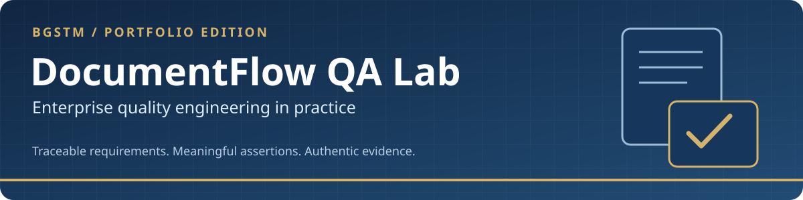
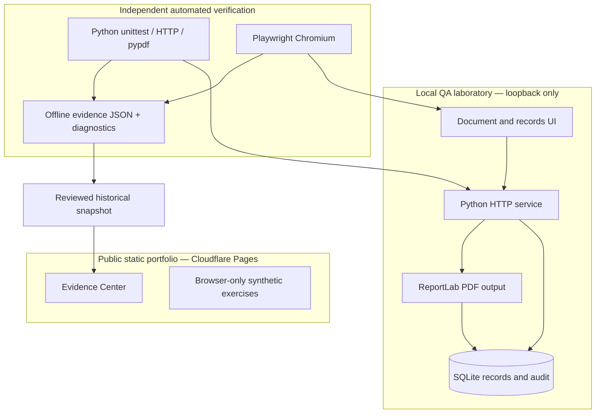

<p align="center">
  
</p>

<p align="center">
  <a href="https://documentflow.bradguider.com"><strong>Explore the public lab</strong></a> ·
  <a href="#verified-release-evidence">Execution evidence</a> ·
  <a href="#run-the-local-lab">Quick start</a> ·
  <a href="https://github.com/bg-playground/BGSTM">BGSTM</a>
</p>

<p align="center">
  <a href="https://github.com/bg-playground/enterprise-uft-qa-lab/actions/runs/45707303024"></a>
  
  
  
  <a href="LICENSE"></a>
</p>

> **Automation is not simply about executing tests faster. It is about creating reliable, repeatable evidence that helps people make better decisions about software quality.**

DocumentFlow is an open-source, synthetic enterprise QA laboratory created by Brad Guider. It connects document processing, print-output simulation, PDF validation, archival, records management, automated testing, defect investigation and release governance in one reproducible project.

It is a practical expression of the [BGSTM quality lifecycle](https://github.com/bg-playground/BGSTM), with a public interactive experience separated from the writable local test environment.

## Explore the Portfolio Edition

| Experience | What to explore |
| --- | --- |
| [Quality Evidence Center](https://documentflow.bradguider.com/#evidence) | Historical cross-platform execution results and links to original CI evidence. |
| [Records exercise](https://documentflow.bradguider.com/#records) | Simulate role decisions, classification, retention boundaries, legal holds and logical disposition. |
| [Defect exercise](https://documentflow.bradguider.com/#defect) | Inject an incorrect body title and see how a semantic comparison detects the mismatch. |
| [Investigation library](docs/knowledge-base/) | Follow a real CI environment failure and a deliberately controlled PDF mutation. |

The public site is a static Cloudflare Pages deployment. Its exercises are educational simulations running in browser memory, not live test executions or authenticated enterprise records services. Independent production HTTP, security-header and browser acceptance remain outstanding at the time of this README update.

## Verified release evidence

<table>
<tr><th>58 / 58</th><th>24</th><th>4 / 4</th><th>0</th></tr>
<tr><td>Passing method executions</td><td>Distinct test methods</td><td>Successful CI jobs</td><td>Failed or skipped methods</td></tr>
</table>

**Historical acceptance snapshot — [Run #24](https://github.com/bg-playground/enterprise-uft-qa-lab/actions/runs/45707303024), November 25, 2026.** These are pre-merge results, not live statistics. Each portable method ran on three operating systems; the seven browser methods ran on Chromium.

| Execution environment | Passed | Evidence archive |
| --- | ---: | --- |
| Linux | 17 | [Portable results](https://github.com/bg-playground/enterprise-uft-qa-lab/actions/runs/45707303024/artifacts/15065248078) |
| Windows | 17 | [Portable results](https://github.com/bg-playground/enterprise-uft-qa-lab/actions/runs/45707303024/artifacts/15066765191) |
| macOS | 17 | [Portable results](https://github.com/bg-playground/enterprise-uft-qa-lab/actions/runs/45707303024/artifacts/15066340861) |
| Playwright Chromium | 7 | [Browser results and screenshots](https://github.com/bg-playground/enterprise-uft-qa-lab/actions/runs/45707303024/artifacts/15065014657) |

- Accepted head: [`6a5ba82`](https://github.com/bg-playground/enterprise-uft-qa-lab/commit/6a5ba82b3d4786c7b09113b761bce975828628b3)
- Merged release: [`a918f26`](https://github.com/bg-playground/enterprise-uft-qa-lab/commit/a918f26854fb7ee727993058ff772fa3ebcef590)
- Acceptance record: [PR #2](https://github.com/bg-playground/enterprise-uft-qa-lab/pull/2#issuecomment-7175603211)

All four Run #24 archive digests were independently matched to GitHub metadata; JSON reports and responsive screenshots were inspected. Traces were inventoried, not replayed. Artifact downloads may require sign-in and expire. The deployed evidence center intentionally preserves its earlier Run #22 snapshot (57 executions / 23 distinct methods). See [all workflow runs](https://github.com/bg-playground/enterprise-uft-qa-lab/actions) for subsequent executions.

## What the lab demonstrates

| Capability | Engineering focus | Traceability |
| --- | --- | --- |
| Document lifecycle | Queued-to-archived transitions, audit and duplicate prevention | SIT-001–007 |
| Browser automation | Shared CSV parameters, UI/API reconciliation and XPath drift | SIT-008–009 |
| PDF quality | Independent parsing, exact text, metadata and SHA-256 reconciliation | SIT-010–011 |
| Records management | Retention boundaries, legal holds, archived search and logical disposition | SIT-012–014 |
| Role-policy simulation | Positive and negative HTTP paths, policy lifecycle and browser workflow | SIT-015–017, SIT-019 |
| Evidence reporting | Validated offline BGSTM-shaped results, malformed-manifest rejection and keyboard checks | SIT-018, SIT-020–024 |

## Architecture



The public edition has no connection to the local database or writable service. Native UFT preparation is a separate, unexecuted track. [Architecture and deployment boundaries](docs/public-demo-architecture.md).

## Quality engineering methodology

BGSTM connects the work from initial risk identification through a defensible release decision.

| Phase | DocumentFlow example |
| --- | --- |
| 01 · Test Planning | Identify risks in document integrity, duplicate processing and records preservation. |
| 02 · Test Case Development | Map requirements to SIT cases and shared synthetic CSV inputs. |
| 03 · Test Environment Preparation | Isolate SQLite databases, loopback servers and browser contexts. |
| 04 · Test Execution | Run portable regression and Chromium tests through GitHub Actions. |
| 05 · Test Results Analysis | Reconcile business content, API state, audit events and execution diagnostics. |
| 06 · Test Results Reporting | Preserve revision-linked evidence, defects, limitations and release decisions. |

[BGSTM repository](https://github.com/bg-playground/BGSTM) · [Initial quality plan](docs/quality-plan.md) · [Illustrative SAFe planning example](docs/safe-worked-example.md) · [Offline External Results preparation](docs/external-results.md)

## Two investigations worth exploring

| Knowledge article | What happened | What it teaches |
| --- | --- | --- |
| [KA-001 · Runner image drift](docs/knowledge-base/KA-001-runner-image-drift.md) | Actual CI setup failure when a floating Linux runner selected an unsupported OS for pinned Playwright. | Diagnose environment failures separately from product defects; pin a compatible runner without weakening assertions. |
| [KA-002 · Incorrect PDF field](docs/knowledge-base/KA-002-template-field-mutation.md) | Deliberate test-only substitution of a wrong body title with valid PDF metadata and matching stored checksum. | Byte integrity alone cannot establish business correctness; semantic assertions matter. |

## Run the local lab

**Prerequisites:** Python 3.12 and Git. Use synthetic data only.

```bash
git clone https://github.com/bg-playground/enterprise-uft-qa-lab.git
cd enterprise-uft-qa-lab
python -m pip install -r requirements.txt
python app.py
```

Open **http://127.0.0.1:8000**. Submit a synthetic ID such as `DOC1` and title `Invoice`. Reenter the ID and process it; observe the transition to archived. Open `/records` to explore simulated policy operations. Local JSON evidence is available at `/api/records` and `/api/audit`; the generated PDF is at `/api/pdf/DOC1` while archived.

### Run automated tests

```bash
# Portable regression
python -m unittest discover -s tests -v

# Browser regression
python -m pip install -r requirements-browser.txt
python -m playwright install chromium
python -m unittest discover -s browser-tests -v
```

On supported Linux environments, browser system dependencies may require `python -m playwright install --with-deps chromium`.

Generate offline execution evidence:

```bash
python run_evidence.py --suite tests --out artifacts/results/portable.json
python run_evidence.py --suite browser-tests --out artifacts/results/browser.json
```

To preview the public static edition locally, run `python -m http.server 8080 --bind 127.0.0.1 --directory portfolio` and open http://127.0.0.1:8080.

## Repository guide

| Location | Purpose |
| --- | --- |
| [`app.py`](app.py) | Local document lifecycle and HTTP service |
| [`record_policy.py`](record_policy.py), [`records_web.py`](records_web.py) | Synthetic records rules and local policy UI |
| [`tests/`](tests/) | Portable service, HTTP, PDF and evidence regression |
| [`browser-tests/`](browser-tests/) | Playwright local and static portfolio acceptance |
| [`test-data/`](test-data/) | Shared synthetic test parameters |
| [`run_evidence.py`](run_evidence.py) | Offline execution report generator |
| [`automation/uft/`](automation/uft/) | Unexecuted VBScript and AOM preparation |
| [`portfolio/`](portfolio/) | Isolated public static experience |
| [`docs/`](docs/) | Quality plans, acceptance notes, investigations and architecture |

Some milestone documents preserve their original candidate-era status for historical context; the release snapshot above describes the subsequently accepted revision.

## Native UFT preparation and honest boundaries

The repository contains illustrative VBScript action source and an unverified AOM launcher. Native UFT execution requires a compatible licensed Windows host, IDE-created test, configured object repository, supported browser and genuine native results. No native UFT execution or proficiency validation is claimed.

The local lab is not a production records system: caller-controlled roles are not authentication, logical disposition is not secure erasure, and physical printing, enterprise indexing, comprehensive concurrency coverage and regulatory compliance are outside the demonstrated scope. BGSTM-shaped JSON is exported offline; live ingestion has not been performed. Targeted keyboard and responsive checks do not constitute comprehensive accessibility certification.

## About the project

Created by [Brad Guider](https://bradguider.com) as a practical professional portfolio project. The companion article, *From SQA Robot to Agentic Testing: What Has Changed — and What Hasn't*, is available as an [editorial draft](docs/portfolio-article-draft.md).

DocumentFlow is independent of OpenText and any prospective employer. It is distributed under the [MIT License](LICENSE).

<p align="center"><strong>Good automation is not merely faster execution. It is better evidence.</strong></p>
